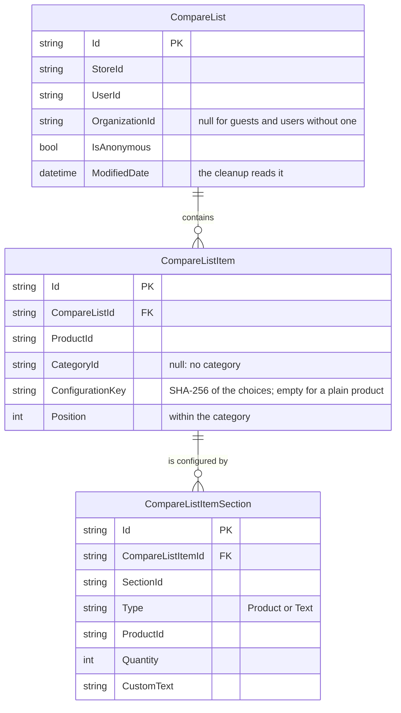

# Virto Commerce Product Comparison Module

The Product Comparison module keeps a storefront buyer's compare list on the server, so the list follows the account
to every device and browser instead of living in one browser's storage. Guests compare too: their list is kept under
the anonymous user id the storefront already uses for the guest cart, and it is merged into the account list when the
guest signs in or registers. The module also ships the storefront's whole compare UI as a Module Federation plugin;
a storefront without the module has no product comparison.

<!-- TODO: add storefront screenshots (the compare page, a product card's compare button) as GitHub asset images. -->

## Key features

* Compare lists stored on the server: one list per user, store and organization, created by the first product added
* Guest compare lists kept the way guest carts are, merged into the account list at sign-in or registration
* Products grouped by category; each category holds up to a per-store number of products (5 by default), and a list
  holds at most 500 products and 1,000 configuration sections in all
* Configurable products compared with the buyer's chosen configuration; section and option names are read from the
  catalog each time, so they stay current and in the shopper's language
* Reorder products within a category, clear one category or the whole list
* Products deleted from the catalog leave every list; a product that no longer exists comes back as `null`, so the
  storefront can show it as "no longer available"
* A daily cleanup job removes guest lists left unchanged for 48 hours, lists of deleted users and lists for
  organizations a user has left
* Per-store switches: product comparison on or off, guest comparison on or off, the per-category limit
* The storefront compare UI as a plugin: the `/compare` page, the add-to-compare buttons, and the header, mobile and
  My Account links

## XAPI specification

All fields are on the main schema, `POST /graphql`. A scoped schema with only this module's types,
`POST /graphql/product-comparison`, exists for the storefront plugin's code generation.

**Who may use a list.** The rules are the guest cart's:

* a signed-in buyer passes their own user id;
* a guest passes the anonymous user id the storefront keeps for them and reaches only guest lists; an id that belongs
  to a registered user is refused;
* an administrator may use any registered user's id. Guest lists stay the guests': an administrator's save under a
  guest's id makes a separate list, which the cleanup deletes, since no user has that id. The organization still
  comes from the administrator's own token, which has none, so an administrator reaches a buyer's list without an
  organization, not the lists the buyer keeps for their organizations.

The organization is never an argument: the list belongs to the organization in the caller's token, so a buyer who
switches organization sees that organization's list. Locked and expired accounts are refused.

### Query

```graphql
query {
  compareList(storeId: "B2B-store", userId: "<user or guest id>", cultureName: "en-US", currencyCode: "USD") {
    id
    itemsCount
    categories {
      id
      category { name }
      items {
        id
        position
        configurationSections {
          sectionId
          type
          productId
          quantity
          customText
          configurationSection { name }
        }
        product { id name price { actual { formattedAmount } } }
      }
    }
  }
}
```

`compareList` returns `null` when the caller has no list yet, when product comparison is off for the store, and for a
guest list while guest comparison is off.

| Type | Field | Description |
|------|-------|-------------|
| `CompareListType` | `id`, `storeId` | |
| | `itemsCount` | Compared products; each category counts up to the store's limit |
| | `items` | Compared products, by category, then by position |
| | `categories` | Products grouped by category, in the order the categories were first added |
| `CompareListCategoryType` | `id` | Category ID; `null` for products without a category |
| | `category` | The catalog's `Category` |
| | `items` | The category's products, by position, at most the store's limit |
| `CompareListItemType` | `id`, `productId`, `categoryId`, `position`, `createdDate` | |
| | `configurationSections` | The chosen configuration of a configurable product |
| | `product` | The catalog's `Product`; `null` when it no longer exists (an inactive or hidden product still comes back: see Accepted limits) |
| `CompareListConfigurationSectionType` | `sectionId`, `type`, `productId`, `quantity`, `customText` | The stored choice |
| | `configurationSection` | The section as the catalog has it now (name, options); `null` when it no longer exists |

### Mutations

Every mutation takes a `command` with `storeId`, `userId` and optionally `cultureName` and `currencyCode` (for the
returned list's products), and returns `CompareListType`. Except for a save, a mutation returns `null` when the caller
has no list yet.

| Mutation | Command fields | What it does |
|----------|----------------|--------------|
| `saveProductsToCompareList` | `products: [{ productId, categoryId, configurationSections }]` | Adds the products that aren't in the list yet, last in their category; creates the list on the first save. A product already in the list with the same configuration stays where it is. One mutation covers plain and configured products, one or many at a time. |
| `removeCompareListItems` | `itemIds` | Removes the given items |
| `clearCompareList` | | Removes every item |
| `clearCompareListCategory` | `categoryId` | Removes one category's items; `null` clears the products without a category |
| `moveCompareListItem` | `itemId`, `position` | Moves the item within its category and renumbers the category from 0 |
| `mergeCompareList` | `secondListId` | Signed-in callers only: merges a guest list into the caller's list and deletes the guest list |

```graphql
mutation {
  saveProductsToCompareList(command: {
    storeId: "B2B-store"
    userId: "<user or guest id>"
    products: [
      { productId: "<product id>", categoryId: "<category id>" }
      {
        productId: "<configurable product id>"
        categoryId: "<category id>"
        configurationSections: [
          { sectionId: "<section id>", type: "Product", option: { productId: "<option product id>", quantity: 1 } }
          { sectionId: "<section id>", type: "Text", customText: "Engraving" }
        ]
      }
    ]
  }) {
    id
    itemsCount
  }
}
```

`configurationSections` takes the cart's `ConfigurationSectionInput`; `Product` and `Text` sections can be compared,
`File` sections can't.

### Errors

A refusal is a GraphQL error whose `extensions.code` names the reason:

| Code | When |
|------|------|
| `COMPARE_LIST_DISABLED` | Product comparison is off for the store |
| `ANONYMOUS_COMPARE_LIST_DISABLED` | A guest saves while guest comparison is off; the storefront asks the guest to sign in |
| `COMPARE_LIST_LIMIT_REACHED` | The save would put more products into a category than the store's limit; nothing is saved |
| `COMPARE_LIST_FULL` | The save, or the merge at sign-in, would put more than 500 products, or more than 1,000 configuration sections in all, into the list |
| `STORE_NOT_FOUND` | No store with the given id |
| `Unauthorized`, `Forbidden` | The caller may not use the given user id |
| `VALIDATION` | The input is malformed or too large: an empty or over-long id, a `File` section, text over 255 characters, more than 500 products or item ids, or more than 1,000 configuration sections, in one call, more than 30 configuration sections for a product, or one section chosen twice |

## How it works

### Lists, guests and sign-in

A list is keyed by user, store and the organization from the token. The first save creates it; the list remembers
whether a guest created it. A guest's list is reached with the guest's anonymous id, so whoever holds that id can read
and edit the list, as with guest carts.

When a guest signs in, the storefront merges the guest list into the account list with `mergeCompareList`:

* per category, the guest's newest products come over first (up to the limit), then the account's newest products
  fill what is left: the incoming products win, as the merge of carts does;
* a product with the same configuration in both lists keeps the account's item, in the account's category: it takes
  no room in the category the guest compared it in;
* a merge that would leave more than 500 products, or more than 1,000 configuration sections, in the list is refused
  with `COMPARE_LIST_FULL`, and both lists stay as they were;
* the guest list is deleted afterwards. A source that no longer exists, belongs to another store or is the account
  list itself leaves the account list unchanged.

Only a signed-in caller can merge, and only a guest list or one of their own.

### Categories and limits

The storefront decides a product's category: the second-level category of its breadcrumbs, as its compare always
grouped products. A product without a category goes to a group with a `null` id. A save that would put more products
into a category than `ProductComparison.MaxItems` is refused as a whole. When the limit is lowered later, a category
over it keeps its products but shows only the first ones up to the limit, and accepts no more until enough are removed.

### Configured products

Only the buyer's choices are stored: the section, the chosen option's product and quantity, or the text. Two items
are the same product when the product and every section's choice match. The section and option names come from the
catalog when the list is read, through the cart's product configuration query, so a renamed option shows its new name
and a removed one shows as no longer available.

### Cleanup

The `CleanupCompareListsJob` recurring job runs daily at 02:00 by default, one run at a time across instances. It
deletes:

* guest lists whose last change is older than `ProductComparison.AnonymousListLifetimeHours` (48 by default); reading
  a list doesn't extend its life, any change does;
* lists of users who no longer exist;
* lists for an organization the user can no longer pick when signing in, because their contact or employee no longer
  belongs to it.

A product deleted from the catalog leaves every list at once, through the catalog's product change event. The
removal is one set-based delete, so it raises no `CompareListChangingEvent` or `CompareListChangedEvent`.

### Storefront plugin

The storefront part is a Module Federation plugin of the B2B storefront (vc-frontend), in
`src/VirtoCommerce.ProductComparison.Web/StorefrontApp`. The module ships its build in `plugins/vc-frontend`; the
storefront finds it through `store.plugins` and loads it only in stores where `ProductComparison.Enabled` is on.
Without the module, or with the setting off, the storefront has no compare at all.

The plugin adds:

* the `/compare` page (route `CompareProducts`): a tab per category, the comparison table with add to cart and
  "Customize", a "no longer available" column with a remove button for an item whose product no longer resolves,
  clear category, clear all, and Restore right after the list was emptied. The page reads the list once the plugin's
  changes still on their way, such as the sign-in merge, are done, and again whenever its browser tab becomes visible,
  since another tab or device may have changed it;
* the compare toggle among a product's action buttons, through the storefront's `productActions` extension point: on
  catalog cards, related products and the product page, where it compares the configurator's current choices;
* the "Compare" link with a count in the header and the mobile menu, and under My Account > Purchasing;
* the sign-in merge: the plugin remembers a guest's list id in the browser, per store, and merges that list into the
  account list on the first page load after sign-in. A merge request that fails on its way is sent again on the next
  page load; a merge the server refuses is not;
* "Customize": the product page opened with `?compareItemId=<item id>` preselects that item's configuration, through
  the storefront's `registerProductConfigurationSource`, when the item is in the viewer's own list.

It needs a storefront whose `@vc-frontend/core` facade is 0.2.8 or later 0.2.x: the version that added
`productActions`, the count on header links and `registerProductConfigurationSource`. An older storefront skips the
plugin.

To work on it, run these in `StorefrontApp`: `yarn install`, `yarn build` (output in `../plugins/vc-frontend`),
`yarn test`, `yarn type-check` and `yarn lint`. `APP_BACKEND_URL=<backend url> yarn generate:graphql-types`
regenerates the GraphQL types: the module's operations from its scoped schema, and the storefront operation the page
also runs (the configured price) from `/graphql`.

### Accepted limits

* Two first saves at the same moment, for example from two tabs, can create a second list for a guest or for a user
  without an organization: the unique key doesn't cover an empty organization. Every lookup then uses the oldest list.
  With an organization the unique key holds, and the second save fails with an error that carries no code.
* Two changes at the same moment each save the list they read, so one can undo the other: an added product goes
  missing, or a removed one comes back. Two saves can each pass the limit check, so a category can end up over the
  limit by what the other save added: a product, when the storefront adds one, or a whole batch saved through the API.
  The 500-product cap can be passed the same way. The list still shows at most the limit per category. The same
  product added twice at once fails once, with an error that carries no code.
* The sign-in merge saves the account list, then deletes the guest list in a separate step: a change to the guest list
  in between, for example from another tab still signed out, is deleted without being merged.
* Variations deleted together with their main product stay in lists. The catalog deletes them in the database, and
  its product change event names only the main product. They show as no longer available until the buyer removes
  them.
* A product made inactive or hidden, or one outside the store's catalog, still shows as a normal column. X-Catalog
  loads products by id without its visibility filters, as the storefront's earlier in-browser compare did too.
  VCST-6715 proposes an option for loads by id that respects them.

> ⚠️ **Multi-instance deployments must configure `ConnectionStrings:RedisConnectionString`.** Lists are cached per
> instance, and only invalidations are shared, over the platform's Redis backplane. Without it, another instance can
> serve a stale list until its cache entry expires.

## Settings

| Setting | Scope | Type | Default | Purpose |
|---------|-------|------|---------|---------|
| `ProductComparison.Enabled` | Per store (public) | Boolean | `true` | Product comparison on the store. Off: the storefront shows no compare UI and the mutations are refused. |
| `ProductComparison.MaxItems` | Per store (public) | Integer | `5` | Products per category. |
| `ProductComparison.AnonymousListEnabled` | Per store (public) | Boolean | `true` | Guest comparison. Off: a guest is asked to sign in when adding a product. |
| `ProductComparison.CleanupAnonymousLists.Enabled` | Module | Boolean | `true` | Runs the cleanup job. |
| `ProductComparison.CleanupAnonymousLists.Cron` | Module | Text | `0 2 * * *` | The cleanup job's schedule. |
| `ProductComparison.AnonymousListLifetimeHours` | Module | Integer | `48` | Hours after its last change that a guest list is deleted. |

The per-store settings are registered for the `Store` type and marked public, so the storefront plugin reads them from
`store.settings.modules`. They replace the theme settings `product_compare_enabled` and `product_compare_limit`, which
the storefront no longer reads. Their values are not carried over: a store that turned compare off or changed the
limit in the theme sets these store settings again.

## Dependencies

| Module | Why |
|--------|-----|
| `VirtoCommerce.Xapi` | GraphQL infrastructure, the scoped schema, the account-state check. |
| `VirtoCommerce.XCatalog` | `Product` and `Category` in the read model, loaded in batches. |
| `VirtoCommerce.XCart` | The configuration input type and the product configuration query behind `configurationSection`. |
| `VirtoCommerce.XFrontend` | Declares the storefront app whose plugins the platform serves. |
| `VirtoCommerce.Catalog` | The product change event that removes deleted products from lists. |
| `VirtoCommerce.Customer` | Contacts' organizations, for the cleanup of lists for organizations a user has left. |
| `VirtoCommerce.Store` | Stores and their settings. |
| `VirtoCommerce.Core` | Currencies for the products' prices. |

## Database



Unique keys: (`UserId`, `StoreId`, `OrganizationId`) on `CompareList`, and (`CompareListId`, `ProductId`,
`ConfigurationKey`) on `CompareListItem`. Migrations exist for SQL Server, PostgreSQL and MySQL.

## Tests

`tests/VirtoCommerce.ProductComparison.Tests` holds the layers, selected by the `Category` trait:

| Category | What runs | Backend |
|----------|-----------|---------|
| `Unit` | The list rules (limits, duplicates, merge, reorder) and the access rules, in isolation. | None. |
| `Component` | The module's real services, repository, job, event handler and GraphQL schema, called in process. | In-memory SQLite created with `EnsureCreated`, and hand-written doubles for the platform parts the module only reads. |
| `StorefrontE2E` | The real storefront with the module's compare plugin, driven by Playwright: a guest adds, compares and removes a product; the add's toast opens the page on the product's category; the sign-in warning when guest lists are off; the sign-in merge, a merge that fails on its way and one refused at the cap; a product that is no longer available; a store with compare off; clearing a category, clear all and restore. Also the compare page's layout at QA's 19 widths, as tests of `Kind=Layout`. | The component harness, hosted on Kestrel inside the test process, with the catalog's product queries answered from memory. |

`dotnet test` runs all three. The end-to-end tests also carry the `IntegrationTest` category, which `vc-build Test`,
and so the module CI, leaves out by default: the CI runner has no storefront. They need a vc-frontend clone (with
`node_modules` and Node 22) or a storefront build, the plugin built (`yarn build` in `StorefrontApp`), and
Playwright's Chromium. [StorefrontE2E/README.md](tests/VirtoCommerce.ProductComparison.Tests/StorefrontE2E/README.md)
has the details and the run command.

**In GitHub, on demand**, the `E2E tests` workflow (`.github/workflows/e2e-tests.yml`) runs them. Start it from
Actions → E2E tests → Run workflow, or with
`gh workflow run e2e-tests.yml --ref <module branch> -f frontend=<vc-frontend ref>`. "Use workflow from" is the
module branch; the `frontend` input is the vc-frontend branch, tag or commit to test against, empty for its latest
release:

* A product-comparison change: its branch, `frontend` empty.
* A change with a vc-frontend part: its branch, and its vc-frontend branch in `frontend`.
* A vc-frontend change alone, a UI kit change for example: `dev`, and that vc-frontend branch in `frontend`.

Until a vc-frontend release carries the host side of VCST-5918, `frontend` names the ticket's vc-frontend branch. The
run builds that storefront and the compare plugin, serves the storefront build (`VC_STOREFRONT_BUILD`) and gives the
contract test the same checkout (`VC_STOREFRONT_DIR`). Its summary names both commits; a failed run attaches the
diagnostics folder as `e2e-diagnostics`. Only a person starts it and no branch rule requires it, so it never blocks a
merge. GitHub shows the Run button once the workflow is on the default branch, and runs the copy on the branch picked.

The storefront plugin has its own specs (Vitest): `yarn test` in `src/VirtoCommerce.ProductComparison.Web/StorefrontApp`.

## Documentation

* [VCST-5918: Product Compare with Server-Side Storage](https://virtocommerce.atlassian.net/browse/VCST-5918), and the
  [decisions comment](https://virtocommerce.atlassian.net/browse/VCST-5918?focusedCommentId=112644)

## References

* [Virto Commerce Documentation](https://docs.virtocommerce.org)
* [Experience API (X-API)](https://github.com/VirtoCommerce/vc-module-x-api)
* [Virto Commerce Frontend](https://github.com/VirtoCommerce/vc-frontend)

## License

Copyright (c) Virto Solutions LTD. All rights reserved.

Licensed under the Virto Commerce Open Software License (the "License"); you may not use this file except in compliance with the License. You may obtain a copy of the License at

<https://virtocommerce.com/open-source-license>

Unless required by applicable law or agreed to in writing, software distributed under the License is distributed on an "AS IS" BASIS, WITHOUT WARRANTIES OR CONDITIONS OF ANY KIND, either express or implied.
